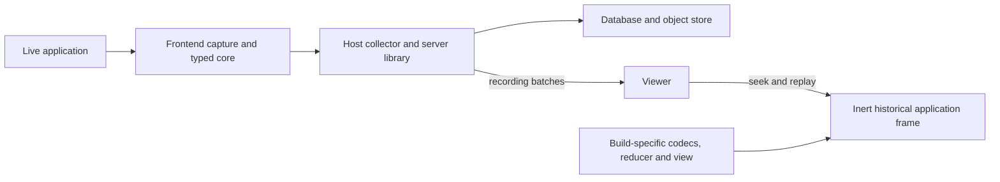

# Retrace

[](https://github.com/gleam-dream/retrace/actions/workflows/ci.yml)
[](https://hex.pm/packages/retrace)
[](https://gleam.run/)

Record selected application state and messages, deliver them durably, and
reconstruct a session for inspection. Retrace includes a portable typed core,
Lustre capture and replay, an optional viewer, and a server package for storage
and retrieval.

The packages are experimental; APIs may change before 1.0.
Browser and Tauri examples use the same application
model; native integration has its own checks and runbook.

## Capabilities

- Record application-native events with typed checkpoints and sequence checks.
- Encode and validate versioned recording batches at the wire boundary.
- Capture accepted Lustre transitions using caller-supplied safe projections.
- Queue delivery through browser persistence or explicit storage/transport adapters.
- Reconstruct a full historical application view in an inert replay frame.
- Inspect recordings through the optional viewer and replaceable data sources.
- Index sessions, admit batches atomically and read them in bounded order.
- Archive through local, S3-compatible or application-supplied object storage.
- Use optional bounded concurrent reads and caller-driven erasure.

## When to use Retrace

- Add replayable inspection to a Lustre browser application using the provided
  persistence, delivery and viewer defaults.
- Retain the view and reducer for a particular application build so a later
  inspection reconstructs the state that build understood.
- Integrate a Tauri shell or your own collector, storage and viewer adapters.

Retrace records explicitly selected state and messages. It does not record pixels,
arbitrary DOM changes, native screens or OS dialogs. The server package is a
library to host, not a managed collection service.

## Packages

| Package                                                   | Owns                                                               | Your application supplies                                       |
| --------------------------------------------------------- | ------------------------------------------------------------------ | --------------------------------------------------------------- |
| `retrace`                                                 | Typed recording, checkpoints, replay and wire validation           | Safe model/events, codecs and deterministic reducer             |
| [`retrace_frontend`](packages/retrace_frontend/README.md) | Lustre capture, durable delivery, replay frame and optional viewer | View, adapters, build artifacts and explicit lifetimes          |
| [`retrace_server`](packages/retrace_server/README.md)     | Admission, indexing, archive and retrieval                         | Routing, authentication, pool, object store and worker lifetime |

## Install

Use Gleam 1.16 or later and add only the packages you import from Hex.
A browser or Tauri application typically starts with:

```sh
gleam add retrace retrace_frontend
```

A backend uses the core and server packages:

```sh
gleam add retrace retrace_server
```

The unpublished [development collector](support/collector/README.md) uses Git+path
alongside these Hex packages.

Commit `gleam.toml` and `manifest.toml` to retain the resolved versions.
The [core-only example](examples/basic/src/usage_core.gleam)
shows recording without Lustre, storage or a network.

## Capture a Lustre session

The [basic inventory application](examples/basic/README.md) supplies the domain
codecs, update function and view. Import `retrace_frontend/capture` and
`retrace_frontend/client`, then connect capture once:

<!-- prettier-ignore-start -->

<!-- snips: examples/basic/src/retrace_inventory.gleam#capture-start -->
```gleam
let session =
  capture.session("Warehouse", domain.build, domain.contract, "web")
let assert Ok(#(recording, connect)) =
  capture.start(
    session,
    client.Config("http://127.0.0.1:4417", "basic-outbox", 100, 1_048_576),
    client.browser_storage(),
    client.http_transport("http://127.0.0.1:4417"),
  )
```

<!-- prettier-ignore-end -->

After accepting a domain command, observe it using the **previous** model. Feed
the returned delivery effect back through the application's capture updates:

<!-- prettier-ignore-start -->

<!-- snips: examples/basic/src/retrace_inventory.gleam#capture-observe -->
```gleam
let #(recording, save) =
  capture.observe(
    model.capture,
    model.stock,
    command,
    domain.encode,
    domain.encode_command,
  )
```

<!-- prettier-ignore-end -->

For replay, keep the build's codecs, pure reducer and full view together in its
replay module. Mount that module in a separate historical entrypoint:

<!-- prettier-ignore-start -->

<!-- snips: examples/basic/src/retrace_inventory/frame.gleam -->
```gleam
import retrace_frontend/replay
import retrace_inventory/domain

pub fn mount() -> fn() -> Nil {
  let assert Ok(dispose) =
    replay.mount(domain.replay_module(), domain.build, "#app", 5000)
  dispose
}

```

<!-- prettier-ignore-end -->

The returned disposer owns the frame's lifetime. The [viewer example](examples/basic/src/retrace_inventory/viewer.gleam)
selects a recording and drives the frame. [Usage topics](examples/README.md#usage-topics)
link each integration step to its source and existing check.

## How it works



The portable core owns recording and replay rules. The frontend owns local
delivery and viewer integration. The host owns server routing and borrowed
resources; importing a package starts no listener, pool or background worker.

## Try the browser example

From the repository root, start the local services:

```sh
nix develop
bash dev/services.sh
```

In a second terminal inside Nix:

```sh
cd examples/basic
npm ci
npm run dev
```

Open **http://127.0.0.1:5193/**, change inventory and choose **Inspect this recording**.
The local PostgreSQL and S3-compatible data remains in ignored `.local/`.
Use the [advanced example](examples/advanced/README.md) for Tauri, immutable
replay artifacts and custom adapters.

## Operational notes

- Project secrets and other unwanted data out before capture. The application
  owns what is recorded and must supply deterministic reducers and safe codecs.
- Retain the historical replay artifact and its build identity. Replaying through
  different code is not a faithful reconstruction of the recorded application.
- The development collector is unauthenticated and loopback-bound. A deployed
  host must supply authentication, tenant isolation, consent and retention policy.
- Monitor persistence and delivery status. A permanently rejected batch can
  block later batches; the application owns outbox and durable-cursor recovery.
- Erasure needs host evidence that uncertain uploads can no longer publish.
  Live tailing, event search and analytics are outside the implemented scope.

See the [design](docs/design/design-layer.pdf) for the recording, archive and replay
contracts. [AGENTS.md](AGENTS.md) separates core, browser, service and native checks;
CI timing checks are not a benchmark suite. [THIRD_PARTY.md](THIRD_PARTY.md) records attribution.
